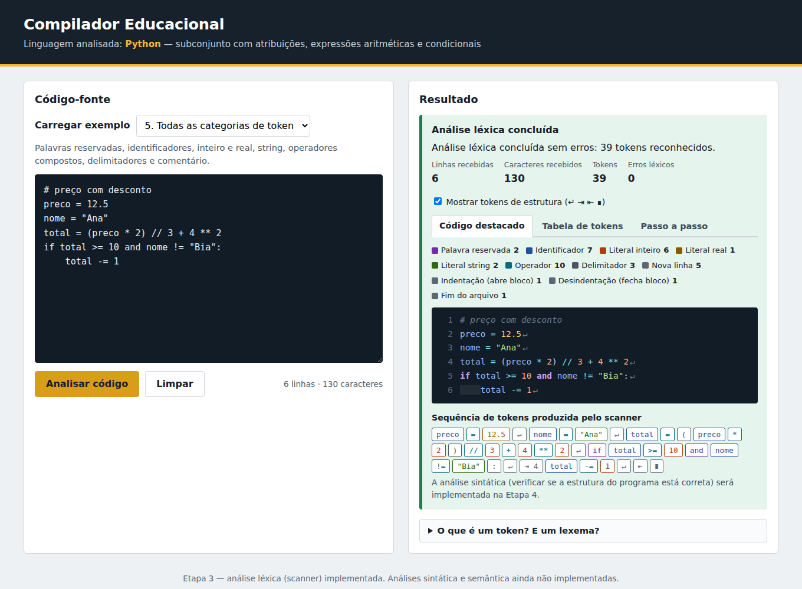
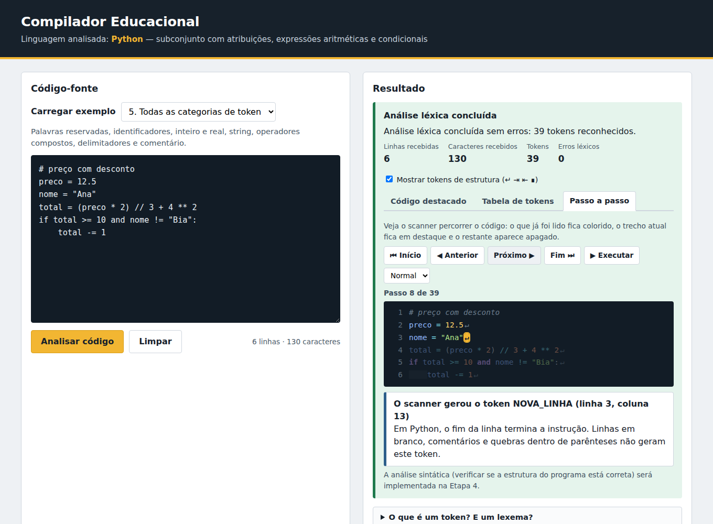
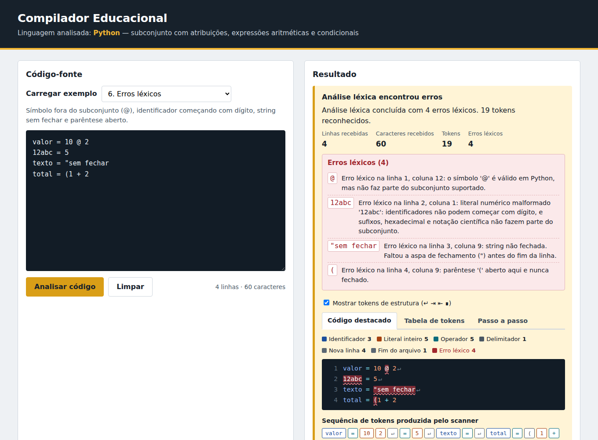

# Compilador Educacional — Python (subconjunto aritmético)

Software educacional para estudantes de Compiladores. O usuário escreve (ou escolhe) um programa em
**Python**, solicita a análise e vê, passo a passo, como o compilador "enxerga" o código.

> **Estado atual (Etapa 3):** análise **léxica** (scanner) implementada e integrada à interface.
> **Ainda não existem** análise sintática (Etapa 4) nem semântica (Etapa 5): o programa não é
> executado nem tem a estrutura verificada. Um código com erro de sintaxe, como `x = 10 +* 5`, é
> tokenizado normalmente — só símbolos que o scanner não reconhece geram erro.



## Sumário
[Escopo léxico](#escopo-léxico-da-linguagem) · [Scanner](#o-scanner) · [Contrato da API](#contrato-da-api) ·
[Exemplos de entrada e saída](#exemplos-de-entrada-e-saída) · [Interface](#interface-e-recursos-didáticos) ·
[Executar](#como-executar) · [Testes](#testes) · [Limitações](#limitações-conhecidas) ·
[Tutorial para alunos](docs/tutorial-lexico.md)

## Escopo léxico da linguagem
Linguagem: **Python 3** (código-fonte em texto Unicode). Colunas e linhas começam em **1**; a coluna conta
*caracteres* (não bytes) e um tab ocupa uma coluna.

| Categoria (`tipo`) | Regra | Exemplos |
|---|---|---|
| `PALAVRA_RESERVADA` | As 35 palavras reservadas do Python 3.8+ (iguais a `keyword.kwlist`): `False None True and as assert async await break class continue def del elif else except finally for from global if import in is lambda nonlocal not or pass raise return try while with yield`. Diferencia maiúsculas de minúsculas. | `if`, `while`, `and`, `True` |
| `IDENTIFICADOR` | Letra (inclusive acentuada) ou `_`, seguida de letras, dígitos ou `_`. `print` é identificador, não palavra reservada. | `numero`, `_x1`, `ação` |
| `LITERAL_INTEIRO` | Dígitos decimais; zeros à esquerda só se o número for só zeros (`00` vale, `007` é erro, como no Python 3). | `0`, `10`, `42` |
| `LITERAL_REAL` | Dígitos, ponto, dígitos. | `3.14`, `0.5` |
| `LITERAL_STRING` | Texto entre aspas simples ou duplas, fechado na mesma linha; `\` protege o caractere seguinte. | `"Ana"`, `'it\'s'` |
| `OPERADOR` | `+ - * / // % **` · `= += -= *= /= //= %= **=` · `== != < > <= >=` (sempre o **maior** casamento: `**=` antes de `**` antes de `*`). | `+`, `==`, `//=` |
| `DELIMITADOR` | `( ) , :` | |
| `NOVA_LINHA` | Fim de uma instrução (ver "Estrutura de Python"). Símbolo `↵`. | |
| `INDENTACAO` / `DESINDENTACAO` | Recuo abre / fecha um bloco. Símbolos `⇥` / `⇤`. | |
| `FIM_ARQUIVO` | Último token de toda análise. Símbolo `∎`. | |
| *(ignorados)* | Espaços, tabs, `\f`, linhas em branco e **comentários** `# ...` até o fim da linha. | |

**Estrutura de Python (tokens estruturais).** Em Python, o recuo e o fim de linha fazem parte da gramática,
por isso o scanner os transforma em tokens, exatamente como o `tokenize` do CPython:
- `NOVA_LINHA` termina cada instrução. Não é gerado para linhas em branco, linhas só com comentário nem
  para quebras **dentro de parênteses** ou após `\` no fim da linha (continuação).
- `INDENTACAO` quando uma linha tem mais recuo que a anterior; `DESINDENTACAO` (uma por bloco fechado)
  quando tem menos. Um tab equivale a avançar até o próximo múltiplo de 8 colunas (como no CPython).
- Ao fim do código, o scanner fecha a última instrução (`NOVA_LINHA` com lexema vazio, se faltar o `\n`)
  e os blocos ainda abertos.

**Caracteres e sequências não reconhecidos → `ERRO_LEXICO`** (o scanner registra o erro e **continua**):

| `subtipo` | Quando |
|---|---|
| `CARACTERE_NAO_RECONHECIDO` | `$ ? ! `` ` `` emoji, caracteres de controle etc. (`!` sozinho sugere `!=`) |
| `FORA_DO_SUBCONJUNTO` | Símbolos válidos em Python mas fora do escopo: `[ ] { } ; . @ \| & ^ ~` e operadores `<< >> -> := <<= >>=` |
| `STRING_NAO_FECHADA` | Aspa sem fechamento até o fim da linha |
| `STRING_TRIPLA` | `"""` ou `'''` (não suportadas; o trecho até o fechamento é ignorado) |
| `NUMERO_MALFORMADO` | `12abc`, `1e5`, `0x1F`, `1.2.3`, `5.`, `.5`, `007` |
| `INDENTACAO_INCONSISTENTE` | Linha volta a um recuo que não corresponde a nenhum bloco aberto |
| `PARENTESE_NAO_FECHADO` / `PARENTESE_SEM_ABERTURA` | `(` sem `)` (apontando para o `(`) / `)` sem `(` |
| `BARRA_INVERTIDA_INVALIDA` | `\` fora de string e que não está no fim de uma linha |

## O scanner
- **Arquivo:** `backend/scanner.py` (função `tokenizar` / `analisar_lexico`). Chamado por `backend/analisador.py`,
  que é o ponto onde o parser (Etapa 4) e a análise semântica (Etapa 5) serão encadeados.
- **Tecnologia:** scanner **escrito à mão** em Python, lendo caractere a caractere (sem `re`, sem geradores).
- **Justificativa:** (1) o código fica legível e pode ser explicado ao estudante (cada método corresponde a uma
  categoria de lexema); (2) o controle de indentação, de parênteses e a recuperação de erros — pontos em que
  Python foge das gramáticas regulares — são mais claros em código explícito do que em ferramentas como
  Lex/PLY/ANTLR; (3) não adiciona dependências, mantendo a imagem Docker idêntica à da Etapa 1.
- **Recuperação de erros:** ao encontrar um problema, registra o erro e segue; todos os erros são devolvidos juntos,
  ordenados por posição.
- **Validação:** para programas sem erro léxico, os testes comparam o resultado (tipo, lexema, linha e coluna,
  inclusive dos tokens de indentação) com o do módulo `tokenize` do próprio CPython.

## Contrato da API
`POST /api/analisar` — corpo `{"codigo": "<texto>"}` (inalterado desde a Etapa 2).

**Resposta `200`** (sempre que a requisição é válida, mesmo que o *código analisado* tenha erros léxicos):

| Campo | Descrição |
|---|---|
| `recebido` | `true` |
| `sucesso` | `true` se **não** houve erro léxico |
| `mensagem` | Resumo em português |
| `estatisticas` | `{linhas, caracteres}` (da Etapa 2) |
| `tokens` | Lista `{tipo, lexema, linha, coluna}` na ordem de leitura; termina em `FIM_ARQUIVO` |
| `erros` | Lista `{tipo: "ERRO_LEXICO", subtipo, lexema, linha, coluna, mensagem}` ordenada por posição |
| `resumo` | `{total_tokens, total_erros, por_categoria}` (todas as categorias, inclusive com 0) |

**Respostas de erro da requisição** (inalteradas, `{"recebido": false, "erro": {"tipo", "mensagem"}}`):

| HTTP | `erro.tipo` | Quando |
|---|---|---|
| 400 | `requisicao_invalida` | JSON ausente/malformado, não é objeto, falta `codigo` ou não é texto |
| 422 | `entrada_vazia` / `entrada_somente_espacos` | código vazio / só espaços (o scanner não chega a ser executado) |
| 413 | `codigo_muito_grande` | mais de 100.000 caracteres (ou corpo > 1 MiB) |
| 404 / 405 | `recurso_nao_encontrado` / `metodo_nao_permitido` | rota ou método inexistente |
| 500 | `erro_interno` | falha inesperada — mensagem genérica, detalhes só no log do servidor |

> **Mudança intencional em relação à Etapa 2:** o texto de `mensagem` deixou de ser "Código recebido com
> sucesso." e passou a descrever a análise léxica. Os demais campos da Etapa 2 foram mantidos. Os testes
> correspondentes foram atualizados (ver `docs/testes.md`).

Outras rotas: `GET /health` → `{"status":"ok"}` e `GET /` (Etapa 1) → `{"message":"Hello, World!"}`.

## Exemplos de entrada e saída
**Entrada:** `numero = 10` → **saída** (campos principais; `resumo` omitido):
```json
{ "recebido": true, "sucesso": true,
  "mensagem": "Análise léxica concluída sem erros: 5 tokens reconhecidos.",
  "tokens": [
    { "tipo": "IDENTIFICADOR",   "lexema": "numero", "linha": 1, "coluna": 1 },
    { "tipo": "OPERADOR",        "lexema": "=",      "linha": 1, "coluna": 8 },
    { "tipo": "LITERAL_INTEIRO", "lexema": "10",     "linha": 1, "coluna": 10 },
    { "tipo": "NOVA_LINHA",      "lexema": "\n",     "linha": 1, "coluna": 12 },
    { "tipo": "FIM_ARQUIVO",     "lexema": "",       "linha": 2, "coluna": 1 } ],
  "erros": [] }
```
**Entrada com erro:** `a = 1 @ 2` → `"sucesso": false`, 6 tokens (o restante da linha continua sendo lido) e:
```json
"erros": [ { "tipo": "ERRO_LEXICO", "subtipo": "FORA_DO_SUBCONJUNTO", "lexema": "@", "linha": 1, "coluna": 7,
  "mensagem": "Erro léxico na linha 1, coluna 7: o símbolo '@' é válido em Python, mas não faz parte do subconjunto suportado." } ]
```

## Interface e recursos didáticos
| Recurso | Descrição |
|---|---|
| **Código destacado** | Cada token colorido por categoria, `↵` no fim de cada instrução, recuos marcados, comentários em cinza, erros sublinhados em vermelho, legenda com a **contagem por categoria** e a **sequência de tokens** abaixo do código (comparação código × tokens). |
| **Tabela de tokens** | `#`, tipo, lexema, linha, coluna. Clicar numa linha abre o token no passo a passo. |
| **Passo a passo** | O scanner "percorre" o código: ⏮ ◀ ▶ ⏭, execução automática com 3 velocidades. Lido = colorido, atual = destacado, restante = apagado; um cartão explica **por que** o trecho virou aquele token (ou o erro léxico). |
| **Erros léxicos** | Lista com lexema, linha, coluna e mensagem didática; não interrompe a análise. |
| **Guia rápido** | "O que é um token? E um lexema?" na própria tela. Tutorial completo em [`docs/tutorial-lexico.md`](docs/tutorial-lexico.md). |
| **Tokens de estrutura** | Caixa para mostrar/ocultar `↵ ⇥ ⇤ ∎`. |
| **Celular** | Layout responsivo (testado em 390 px sem rolagem horizontal). |




### Exemplos disponíveis
| # | Exemplo | O que demonstra |
|---|---|---|
| 1 | Atribuição de variável | identificador, `=`, literal inteiro, `print` |
| 2 | Operações aritméticas | `+ - * / //`, parênteses |
| 3 | Estrutura condicional | `if`, `>`, `:`, `INDENTACAO`/`DESINDENTACAO` |
| 4 | Erro de sintaxe (não léxico) | `+*` seguidos: tokens válidos, o scanner **não** reclama (será do parser) |
| 5 | Todas as categorias de token | palavras reservadas, real, string, `// ** >= != -=`, comentário |
| 6 | Erros léxicos | `@`, `12abc`, string sem fechar, `(` aberto — quatro erros de uma vez |
| 7 | Blocos e indentação | `while` com `if` aninhado: vários `INDENTACAO`/`DESINDENTACAO` |

## Como executar
```bash
docker compose up --build        # inicia (primeira vez constrói as imagens)
# acesse http://localhost:8080
docker compose down              # encerra
```
O navegador acessa só `http://localhost:8080`; o Nginx encaminha `/api/*` e `/health` ao serviço `backend`
(`backend:5000`) pela rede do Docker. A porta 5000 também é exposta para depuração. Não há variáveis de ambiente
nem credenciais. A Etapa 3 **não adicionou dependências** (o scanner usa só a biblioteca padrão do Python), então
os Dockerfiles e o `docker-compose.yml` não precisaram mudar; o frontend apenas ganhou dois arquivos `.js`.

Tecnologias: frontend em HTML/CSS/JavaScript puro servido por Nginx; backend em Python 3.9 + Flask.

## Testes
```bash
./scripts/run_tests.sh                      # toda a suíte, sem Docker (Git Bash/Linux/macOS)
# ou separadamente:
(cd backend  && python3 -m unittest discover -s tests -t . -v)   # scanner + API
(cd frontend && node --test tests/*.test.js)                     # lógica do frontend
python3 -m unittest discover -s tests/e2e -t tests/e2e -v        # interface + ponta a ponta
./tests/deploy/check_compose.sh             # implantação (precisa de Docker)
python3 tests/deploy/smoke_test.py http://localhost:8080          # stack já em execução
```
Requisitos: Python 3 com `flask`, Node 18+, e para a interface `pip install playwright && playwright install chromium`.
No Windows (cmd/PowerShell), rode os comandos separados acima em vez do `.sh`.

Última execução completa (detalhes, falhas encontradas e verificação por mutação em [`docs/testes.md`](docs/testes.md)):
**197 testes aprovados, 0 reprovados** — 110 backend (scanner, API, regressão), 33 do frontend, 54 de interface/ponta a ponta.
O teste do Docker Compose (`check_compose.sh`) **ainda precisa ser executado** em uma máquina com Docker.

## Limitações conhecidas
- Só a análise léxica está implementada. **Análise sintática: Etapa 4. Análise semântica: Etapa 5.** O programa não é executado.
- Fora do escopo léxico (geram erro): `[ ] { } ; .`, operadores bit a bit, `@`, `:=`, `->`, `...`, strings de aspas triplas,
  prefixos de string (`f"..."`, `r"..."`: o prefixo vira identificador), notação científica, hexadecimal/octal/binário,
  `_` em números e números complexos.
- Sequências de escape dentro de strings não são validadas (`"\q"` é aceito).
- Todas as palavras reservadas do Python são reconhecidas, mas a gramática (Etapa 4) usará apenas parte delas.
- Tab = próximo múltiplo de 8, sem a verificação de mistura tab/espaço que o CPython faz.
- Programas com mais de ~5.000 eventos (tokens + erros) exibem só a tabela (limitada); destaque e passo a passo ficam desativados.
- O conteúdo do editor não é salvo ao recarregar a página.
- Testes verificados com Python 3.12; a sintaxe do backend foi checada para 3.9 (versão da imagem Docker), mas a suíte não foi executada nessa versão.
