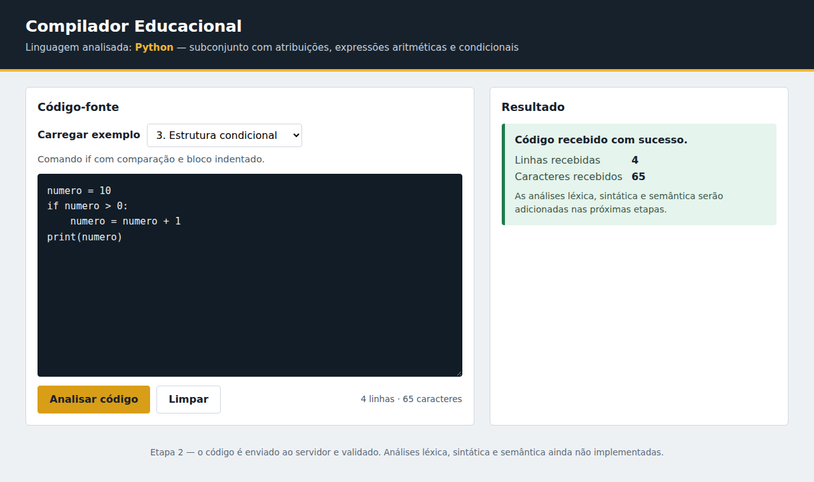

# Compilador Educacional — Python (subconjunto aritmético)

Software educacional para estudantes de Compiladores. O usuário escreve (ou escolhe) um programa em
**Python**, solicita a análise e vê a resposta do sistema. As análises léxica, sintática e semântica
serão adicionadas nas próximas etapas.

> **Estado atual (Etapa 2):** interface web, entrada/edição de código, exemplos, comunicação
> frontend ↔ backend, validações e testes automatizados. **Ainda não há análise léxica, sintática
> ou semântica**: o backend apenas valida o código e informa quantas linhas/caracteres recebeu.



## Linguagem e subconjunto previsto
Python, restrito a: atribuição de variáveis, literais inteiros, operadores aritméticos
(`+ - * / //`), parênteses, comparações, `if` com bloco indentado e `print()`.

## Tecnologias
| Camada | Tecnologia |
|---|---|
| Frontend | HTML, CSS e JavaScript puro (sem build), servido por **Nginx** |
| Backend | **Python 3.9 + Flask** (API JSON) |
| Orquestração | Docker Compose (com *healthchecks*) |
| Testes | `unittest` (backend), `node:test` (JS), **Playwright** (interface/ponta a ponta) |

## Como executar
```bash
docker compose up --build        # inicia (primeira vez constrói as imagens)
# acesse http://localhost:8080
docker compose down              # encerra
```
O navegador acessa só `http://localhost:8080`; o Nginx encaminha `/api/*` e `/health` ao serviço
`backend` pela rede interna do Docker (`backend:5000`). Assim não há dependência de `localhost:5000`
no código do frontend. A porta 5000 também fica exposta para depuração. Não há variáveis de ambiente
nem credenciais.

## Uso da interface
- **Carregar exemplo:** o seletor preenche a área de código (substituindo o conteúdo atual); o texto pode ser editado antes de analisar.
- **Área de código:** campo monoespaçado onde se digita/cola qualquer texto — inclusive código com erros, que é aceito.
- **Analisar código:** valida e envia ao backend; o retorno aparece em **Resultado**.
- **Limpar:** esvazia o campo e o resultado.

### Exemplos disponíveis
| # | Exemplo | Construções demonstradas |
|---|---|---|
| 1 | Atribuição de variável | atribuição, literal inteiro, `print()` |
| 2 | Operações aritméticas | `+ - * / //`, precedência, parênteses |
| 3 | Estrutura condicional | `if`, comparação `>`, bloco indentado |
| 4 | Com erro intencional | `10 +* 5` — erro que as próximas etapas deverão detectar |

## Contrato da API
`POST /api/analisar` — corpo `{"codigo": "<texto>"}`

Sucesso (`200`):
```json
{"recebido": true, "mensagem": "Código recebido com sucesso.", "estatisticas": {"linhas": 2, "caracteres": 26}}
```
Erro: `{"recebido": false, "erro": {"tipo": "...", "mensagem": "..."}}`

| HTTP | `erro.tipo` | Quando |
|---|---|---|
| 400 | `requisicao_invalida` | JSON ausente/malformado, não é objeto, falta `codigo` ou não é texto |
| 422 | `entrada_vazia` | `codigo` é `""` |
| 422 | `entrada_somente_espacos` | `codigo` só tem espaços, tabs ou quebras de linha |
| 413 | `codigo_muito_grande` | mais de 100.000 caracteres (ou corpo > 1 MiB) |
| 404 / 405 | `recurso_nao_encontrado` / `metodo_nao_permitido` | rota/método inexistente |
| 500 | `erro_interno` | falha inesperada — mensagem genérica, detalhes só no log do servidor |

Outras rotas: `GET /health` → `{"status":"ok"}` e `GET /` (da etapa 1) → `{"message":"Hello, World!"}`.

**Mensagens no frontend:** entrada vazia/espaços (validada antes do envio **e** de novo no backend),
falha de comunicação (rede fora, timeout de 10 s, 502/503/504 do proxy) e erro inesperado são
exibidos com estilos distintos e sem expor detalhes internos.

## Estrutura
```
backend/   app.py (rotas e erros) · validators.py (validação) · analisador.py (ponto de extensão p/ etapas futuras) · tests/
frontend/  index.html · style.css · nginx.conf · js/{validacao,exemplos,api,app}.js · tests/
tests/     e2e/ (Playwright) · deploy/ (smoke test e verificação do Compose)
scripts/   run_tests.sh      docs/   testes.md e capturas de tela
```

## Testes
```bash
./scripts/run_tests.sh                      # toda a suíte, sem Docker
# ou separadamente:
(cd backend  && python3 -m unittest discover -s tests -t . -v)   # backend
(cd frontend && node --test tests/*.test.js)                     # JS unitário
python3 -m unittest discover -s tests/e2e -t tests/e2e -v        # interface + ponta a ponta
# implantação (precisa de Docker):
./tests/deploy/check_compose.sh             # build + up --wait + smoke test + down
python3 tests/deploy/smoke_test.py http://localhost:8080          # stack já em execução
```
Requisitos locais: Python 3 com `flask` (e `flask-cors`), Node 18+, e para a interface
`pip install playwright && playwright install chromium`.

Resultados e histórico: veja [docs/testes.md](docs/testes.md).

## Limitações conhecidas
- Não há análise léxica, sintática nem semântica; o programa não é executado.
- Os exemplos ficam no frontend (`js/exemplos.js`); não há realce de sintaxe nem numeração de linhas.
- O conteúdo do editor não é salvo ao recarregar a página.
- O teste de implantação com Docker (`check_compose.sh`) existe, mas **não foi executado** no ambiente de desenvolvimento desta entrega (sem Docker disponível) — veja `docs/testes.md`.
